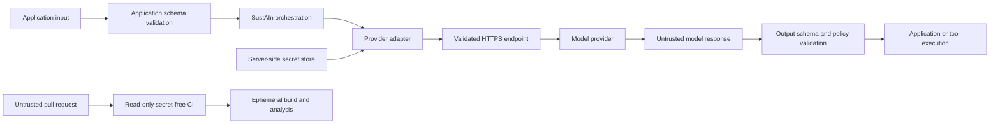

# Security architecture

Verified on August 21, 2026.

## Security objectives

SustAIn must prevent untrusted pull requests, provider configuration, model responses, and application inputs from crossing credential or execution boundaries without deterministic validation.

The repository is a library and example workspace. It does not provide user authentication, tenant isolation, a database access policy, or a sandbox for model-generated code. Applications that add those capabilities must enforce them outside the model context.

## Trust boundaries

No arrow should connect model output directly to a shell, database mutation, network tool, or privileged application action.

## Threats and controls

| Threat                                 | Boundary                         | Implemented control                                                                                                                        | Remaining responsibility                                                                                                     |
| -------------------------------------- | -------------------------------- | ------------------------------------------------------------------------------------------------------------------------------------------ | ---------------------------------------------------------------------------------------------------------------------------- |
| API key sent to attacker origin        | Client or provider HTTP          | Exact auth-origin matching, secure base-URL validation, redirect rejection, host allowlist support                                         | Keep URLs out of end-user control; rotate exposed keys.                                                                      |
| Client-side network pivot              | Generated React API client       | Deny-by-default absolute origins, explicit exact-origin registration, HTTPS credential origins, redirect rejection                         | Build allowlists from trusted application configuration, not request data.                                                   |
| Server-side request forgery            | Universal connector              | HTTP(S)-only URLs, embedded-credential rejection, private and link-local address blocking, explicit private-network opt-in, host allowlist | Use egress firewall or proxy controls for high-assurance deployments; DNS and network policy remain infrastructure concerns. |
| Header injection or request smuggling  | Universal connector              | CR/LF rejection and forbidden hop-by-hop headers                                                                                           | Reverse proxy must normalize and validate its own inbound traffic.                                                           |
| Oversized or stalled provider response | Provider HTTP                    | Abort timeout, streamed byte limit, content-length precheck                                                                                | Set lower workload-specific limits where appropriate.                                                                        |
| Model-output injection                 | Model/application                | Connector returns text and structured usage only; documentation requires output schemas                                                    | Application must validate content, authorize tools separately, and use least-privilege execution.                            |
| Malicious pull request steals secrets  | GitHub Actions                   | No `pull_request_target`, read-only permissions, checkout credentials disabled, no provider secrets in PR jobs                             | Configure the GitHub branch ruleset and audit installed GitHub Apps.                                                         |
| Dependency compromise                  | Package manager                  | Lockfile, strict peers, 24-hour release delay, explicit native-build allowlist, dependency review                                          | Review lockfile and lifecycle changes; use trusted publishing and provenance.                                                |
| Action tag takeover                    | CI                               | Actions pinned to immutable commit SHAs                                                                                                    | Dependabot updates require review of the new commit and release provenance.                                                  |
| Secret committed to source             | Repository                       | Broad ignore patterns, placeholder-only env example, CI secret scan, log redaction                                                         | Enable GitHub secret scanning and push protection; rotate detected secrets.                                                  |
| Cross-tenant cache disclosure          | Exact and semantic caches        | Caller namespace plus exact provider and model partitioning                                                                                | Derive the namespace from authenticated server context, never an untrusted body field.                                       |
| Browser cross-origin exposure          | Example API                      | Exact CORS allowlist, limited methods and headers, Helmet, request limits                                                                  | Use bearer authorization or a CSRF-protected cookie design; configure exact production origins.                              |
| Log credential exposure                | API server                       | Pino redaction for auth, cookies, API keys, tokens, passwords; query strings excluded                                                      | Avoid logging raw prompts or model responses unless a reviewed data policy permits it.                                       |
| Denial of service                      | API server and provider adapters | Rate limiting, JSON and form caps, timeouts, max response size, bounded shutdown                                                           | Add distributed rate limiting, queue limits, budgets, and DDoS protection for multi-instance deployment.                     |

## Provider endpoint policy

`UniversalProvider` and custom hosted-provider base URLs apply these rules:

1. Only `https:` and `http:` schemes are parsed.
2. Embedded URL credentials and fragments are rejected.
3. Non-loopback HTTP is rejected unless explicitly enabled for a trusted development network.
4. Private, link-local, and metadata-network literals are rejected unless private-network access is explicitly enabled.
5. `allowedHosts` performs exact, case-insensitive hostname matching.
6. Redirects fail rather than forwarding credentials.
7. Hop-by-hop headers and line breaks are rejected.
8. Requests time out and responses have a byte limit.

For production, place outbound inference traffic behind an egress proxy or firewall that resolves DNS and enforces destination IP ranges. Application-layer hostname checks alone do not eliminate DNS rebinding or compromised-DNS risk.

## Generated client request policy

The generated React API client rejects an absolute request unless its origin matches one of four trusted sources:

1. The origin configured with `setBaseUrl`.
2. The current browser origin.
3. An origin registered with `setRequestOrigins`.
4. An origin registered with `setAuthTokenOrigins`.

The two explicit lists must be static application configuration. Do not populate them from a request body, query string, model response, imported issue text, or other untrusted input. Credential origins require HTTPS outside loopback, and every request rejects redirects so a trusted hostname cannot redirect the client to another network boundary.

## Prompt and tool injection

Provider content is untrusted even when it came from a system prompt or a reputable model. A production AI execution system should separate:

1. Model reasoning and text generation.
2. Tool selection.
3. Deterministic argument validation.
4. User and tenant authorization.
5. Permission-scoped execution.
6. Result validation and audit logging.

A tool call should carry an explicit principal, tenant, resource, action, and idempotency key. The executor must authorize these fields without trusting the model’s explanation. High-impact actions need a policy gate or human approval appropriate to their risk.

## API server deployment

The example server is a hardened baseline, not a complete public AI gateway.

Required production settings:

- Set `CORS_ORIGINS` to exact HTTPS origins. Do not use a wildcard with credentials.
- Set `TRUST_PROXY_HOPS` only to the number of trusted reverse-proxy hops.
- Terminate TLS at a maintained proxy or platform edge.
- Add authentication and authorization before any non-public route.
- Use a shared rate-limit store for multiple instances.
- Keep provider keys in a managed server-side secret store.
- Restrict outbound network access to approved provider endpoints.
- Send structured logs to access-controlled storage with retention limits.
- Monitor 4xx/5xx rates, timeouts, response sizes, provider errors, and rate-limit events.

## GitHub repository settings

Files in the repository cannot enforce hosted settings. Configure these controls in GitHub:

### Branch ruleset for `main`

- Require a pull request before merge.
- Require at least one approval; use two for workflow, provider, auth, or publishing changes.
- Require Code Owner review.
- Dismiss stale approvals when new commits arrive.
- Require approval of the most recent push.
- Require all conversations resolved.
- Require `CI`, `Dependency review`, `CodeQL`, and `Secret scan` checks.
- Block force pushes and branch deletion.
- Apply rules to administrators or narrowly document bypass roles.
- Require signed commits when the contributor workflow supports them.
- Use merge queue for high-concurrency maintenance.

### Repository security

- Enable private vulnerability reporting.
- Enable Dependabot alerts and security updates.
- Enable secret scanning and push protection.
- Enable code scanning default setup only if it does not duplicate the repository CodeQL workflow.
- Restrict Actions to selected verified actions where organizational policy permits.
- Set the default `GITHUB_TOKEN` permission to read repository contents.
- Require approval for workflows from first-time external contributors.
- Review installed GitHub Apps and deploy keys quarterly.

### Publishing

- Use npm trusted publishing with GitHub OIDC when a release workflow is added.
- Protect the npm package with phishing-resistant MFA.
- Publish provenance attestations.
- Inspect `pnpm pack --dry-run` output.
- Keep release workflows on protected refs and separate them from pull-request CI.
- Do not expose long-lived npm tokens to a workflow that checks out untrusted code.

## Incident response

For a suspected credential leak:

1. Revoke the credential at the provider.
2. Determine its permissions, projects, and exposure window.
3. Review provider and GitHub audit logs.
4. Rotate dependent credentials and sessions.
5. Preserve relevant logs without copying secrets.
6. Remove the source exposure and add a regression test.
7. Rewrite Git history only after rotation and coordinated maintainer notice.

For a compromised dependency or action, disable affected workflows or releases, pin a known-good version, inspect build artifacts and package provenance, rotate reachable credentials, and publish a scoped advisory when impact is established.
